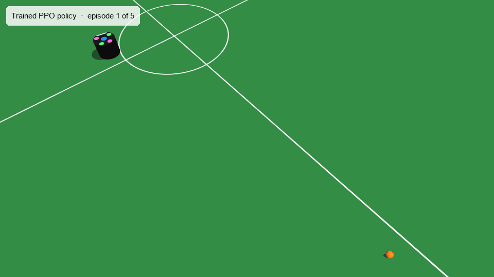
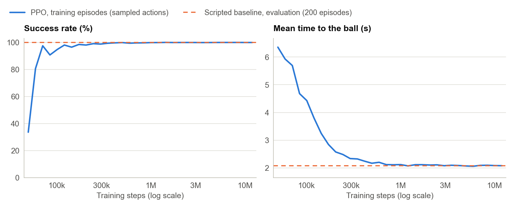
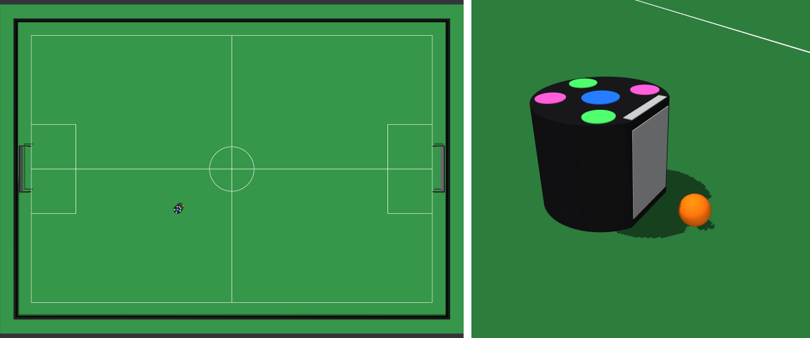

<h1 align="center">RoboCup Small Size League in MuJoCo</h1>

<p align="center">
  <b>An SSL robot learns to reach the ball on a rule-sized Division B field.</b><br>
  The field, ball and robot are built in MuJoCo from the league's rules. A Gymnasium task asks the robot
  to reach the ball and face it; a PPO policy trained for 26 minutes on an Apple M1 CPU is compared
  with a hand-tuned controller on 200 seeded episodes.
</p>

<p align="center">
  
  
  
  <a href="LICENSE"></a>
  <a href="https://github.com/midhunshyam/MuJoCo-RoboCup-SSL/actions/workflows/ci.yml"></a>
</p>

<p align="center"></p>
<p align="center"><sub><i>The trained PPO policy on the first five evaluation seeds (1000 to 1004), in real time. Each episode has its own fixed camera, placed in front of where the robot finishes. Rendered offscreen with MuJoCo by scripts/render_media.py.</i></sub></p>

<p align="center">
  <a href="#results">Results</a> ·
  <a href="#what-is-modelled">What is modelled</a> ·
  <a href="#the-task-gotoball">The task</a> ·
  <a href="#quickstart">Quickstart</a> ·
  <a href="#project-layout">Layout</a> ·
  <a href="#design-notes-and-simplifications">Design notes</a> ·
  <a href="#roadmap">Roadmap</a>
</p>

---

## At a glance

| Part | Summary |
|---|---|
| Field | SSL Division B: 9 m × 6 m playing area, 0.3 m margin to the walls, 1 m goals, all field lines |
| Ball and robot | Orange golf ball (0.043 m, 0.046 kg) with rolling friction. Holonomic robot inside the rules' 0.18 m × 0.15 m cylinder, with a flat front, 2 m/s and 4 rad/s |
| Task | `RoboCupSSL/GoToBall-v0`: bring the front within 3 cm of the ball, facing it to within 15°, in 10 s |
| Learning | PPO (Stable-Baselines3), 12M steps over 8 parallel environments, 26 minutes on an 8-core Apple M1 CPU |
| Result | Both controllers reached the ball in 200 of 200 evaluation episodes. Mean time to the ball: PPO 2.05 s, scripted controller 2.07 s; PPO was faster on 176 of the 200 seeds |
| Checks | 45 pytest cases on the rule dimensions, physics, seeding, success and reward; CI on Python 3.9 and 3.12 |

## Results

Both controllers ran the same 200 evaluation episodes (seeds 1000 to 1199), which were used
neither for training nor for tuning the baseline. `results/eval.json` holds the summary and every
episode; the table is `results/eval.md`.

| Controller | Reached the ball | Success, 95% interval | Time to ball, mean ± sd (s) | Median (s) | 90th percentile (s) |
|---|---|---|---|---|---|
| PPO | 200 of 200 | 98.1–100.0% | 2.05 ± 0.88 | 1.94 | 3.21 |
| Scripted baseline | 200 of 200 | 98.1–100.0% | 2.07 ± 0.88 | 1.96 | 3.23 |

Both reached the ball every time, so the comparison comes down to speed. Seed by seed, PPO
was faster in 176 episodes and slower in 6, with 18 ties at the 20 ms control step. Its mean
time was 0.028 s lower (95% bootstrap interval 0.025 to 0.031 s). The margin is small, and the
baseline had been tuned on other seeds to be as fast as it could be without disturbing the ball.
Neither controller touched a wall, left the field or ran out of time. PPO pushed the ball more
than 5 cm before reaching it in 2 episodes (by 0.69 m on seed 1168); the baseline never did,
because it holds back while it turns.

The scripted baseline (`src/mujoco_ssl/baseline.py`) is a proportional controller in the robot
frame. It commands a velocity of 5 s⁻¹ times the offset to the point where its front would meet
the ball, aims 4 cm into the ball so the approach does not stall, keeps an extra 0.12 m back per
radian of heading error and turns at 6 s⁻¹ times the heading error. Its gains were tuned on seeds
0 to 199.

<p align="center"></p>
<p align="center"><sub><i>Success rate and mean time to the ball (successful episodes only) for the training episodes of all eight environments, in windows that widen along the log axis. Training episodes sample their actions, so they run a little slower than the deterministic evaluation. The dashed line is the scripted baseline's evaluation result. Drawn by scripts/plot_training.py from the Monitor logs; the values are in results/training_curve.csv.</i></sub></p>

PPO learned to reach the ball early. Over the first 50,000 training steps 34% of episodes
succeeded, and between 59,669 and 71,209 steps 97.5% did. The rest of the run went into speed:
the mean time to the ball in training episodes fell from 6.35 s to 2.12 s by 709,084 steps and
was 2.08 s in the last window. The run took 12 million steps and 26 minutes, the budget set for
it; nearly all of the improvement came in its first million steps.

## What is modelled

<p align="center"></p>
<p align="center"><sub><i>Left: the whole field from the top camera. Right: the robot and the ball up close; the light plate and bar mark the flat front. Rendered with MuJoCo by scripts/render_media.py.</i></sub></p>

`src/mujoco_ssl/scene.py` builds the whole scene from the values in `src/mujoco_ssl/field.py`.
Field and ball values follow the Division B section of the [SSL rules](https://robocup-ssl.github.io/ssl-rules/sslrules.html);
everything else is a choice made here and marked as such. `assets/ssl_field.xml` is the exported
MJCF, for reading or for opening in MuJoCo's viewer.

| Field | Value | Source |
|---|---|---|
| Playing area, between line centres | 9.0 m × 6.0 m | Rules |
| Field lines | 0.01 m wide: touch lines, goal lines, halfway line, goal-to-goal line | Rules |
| Margin from the field lines to the walls | 0.3 m on all sides | Rules |
| Carpet beyond the field lines | 0.7 m | Rules (minimum) |
| Centre circle | 0.5 m radius | Rules |
| Defence area | 2.0 m along the goal line, 1.0 m deep | Rules |
| Goals | 1.0 m wide inside, 0.18 m deep, walls 0.16 m high and 0.02 m thick | Rules |
| Boundary walls | 0.1 m high, 0.05 m thick | Chosen here |

| Ball | Value | Source |
|---|---|---|
| Diameter and mass | 0.043 m, 0.046 kg | Rules |
| Sliding friction | 0.35 | Chosen here |
| Rolling friction | 0.0012 m (MuJoCo's rolling coefficient) | Chosen here |

| Robot | Value | Source |
|---|---|---|
| Size | Fits a cylinder 0.18 m wide and 0.15 m high | Rules |
| Front | Cut flat 0.075 m from the centre, leaving a 0.10 m face | Chosen here |
| Mass | 2.5 kg | Chosen here |
| Speed limits | 2 m/s in any direction, 4 rad/s | Chosen here |
| Acceleration limits | 3 m/s² along each robot axis, 20 rad/s² | Chosen here |
| Top | Black, with colour markers in the style of the SSL vision pattern (decoration only) | Rules (black top) |

MuJoCo steps the physics every 2 ms and the policy acts every 20 ms (50 Hz). Measured in the model
(`results/dynamics.json`): a ball launched at 2 m/s without spin takes 0.19 s to spin up, then rolls with a
deceleration of 0.36 m/s² and stops 3.29 m from where it started, 4.46 s after launch. From
rest, the robot reaches 95% of its top speed in 0.68 s and covers 1.3 m in the first second; it
reaches 95% of its top turn rate in 0.24 s.

## The task: GoToBall

Each episode puts the robot (with a random heading) and the ball at random places on the field, at
least 0.3 m inside the field lines and at least 0.5 m apart. The robot has to bring the centre of its
flat front within 3 cm of the ball's surface while the ball is no more than 15° off its heading.

| Observation | Quantity | Frame | Divided by |
|---|---|---|---|
| 0, 1 | Ball position relative to the robot | Robot | 4.5 m |
| 2 | Distance from the robot's centre to the ball's centre | | 4.5 m |
| 3, 4 | Sine and cosine of the bearing to the ball | Robot | |
| 5, 6 | Ball velocity | Robot | 2 m/s |
| 7, 8 | Robot velocity | Robot | 2 m/s |
| 9 | Robot yaw rate | | 4 rad/s |
| 10, 11 | Sine and cosine of the robot's heading | Field | |
| 12, 13 | Robot position | Field | 4.5 m (x), 3.0 m (y) |

| Action | Command, in the robot frame | Range |
|---|---|---|
| 0 | Forward speed | −2 to 2 m/s |
| 1 | Leftward speed | −2 to 2 m/s |
| 2 | Yaw rate | −4 to 4 rad/s |

Actions lie in [−1, 1] and scale linearly to these ranges; the forward and leftward speeds together
are clipped to 2 m/s.

The reward pays for closing the gap and for turning towards the ball, through the change in a
potential, and adds a bonus for success:

```math
r_t = \Phi(s_{t+1}) - \Phi(s_t) - 0.01 - 0.01\,\overline{a_t^2} + 10\,[\mathrm{success}] - 5\,[\mathrm{out}],
\qquad
\Phi(s) = -\left(d + 0.5\,\frac{|\theta|}{\pi}\right)
```

Here $`d`$ is the gap in metres between the centre of the front face and the ball's surface,
$`\theta`$ is the bearing of the ball from the robot's heading, $`\overline{a_t^2}`$ is the mean
squared action, and a bracketed condition counts 1 on the step where it ends the episode.

| Episode ends when | Ends as | Extra reward |
|---|---|---|
| The gap is at most 3 cm and the heading error at most 15° | Terminated, success | +10 |
| The robot's centre crosses a field line, or the ball fully crosses one | Terminated, out | −5 |
| 10 s (500 steps) have passed | Truncated | |

## Quickstart

Python 3.9 or newer. The `train` extra brings in Stable-Baselines3, PyTorch, Matplotlib and Pillow;
the environment alone needs only MuJoCo, Gymnasium and NumPy.

```bash
git clone https://github.com/midhunshyam/MuJoCo-RoboCup-SSL.git
cd MuJoCo-RoboCup-SSL
python -m venv .venv && source .venv/bin/activate
pip install -e ".[train,dev]"
```

Use the environment like any other Gymnasium task:

```python
import gymnasium as gym
import mujoco_ssl  # registers RoboCupSSL/GoToBall-v0

env = gym.make("RoboCupSSL/GoToBall-v0")
obs, info = env.reset(seed=0)
obs, reward, terminated, truncated, info = env.step(env.action_space.sample())
```

`reset` also takes a fixed start, for example
`env.reset(options={"robot_pose": (-1.0, 0.5, 0.0), "ball_position": (1.0, 0.0)})`.

| Step | Command | Notes |
|---|---|---|
| Watch the trained policy | `python scripts/demo.py` | On macOS the passive viewer needs `mjpython scripts/demo.py` (installed with MuJoCo). Add `--baseline` for the scripted controller. |
| Evaluate | `python scripts/evaluate.py` | 200 episodes per controller, about 9 s; writes `results/eval.json` and `results/eval.md` |
| Train | `python scripts/train.py` | 12M steps, 26 minutes on an 8-core Apple M1; replaces `models/ppo_go_to_ball.zip` and `results/training_run.json`. For a quick check that leaves them alone: `python scripts/train.py --timesteps 300000 --model-out runs/quick.zip --summary-out runs/quick.json` |
| Plot training | `python scripts/plot_training.py` | Reads the Monitor files in `runs/ppo_go_to_ball/monitor` |
| Render the GIF and still | `python scripts/render_media.py` | Offscreen; on a headless Linux machine set `MUJOCO_GL=egl` |
| Measure the dynamics | `python scripts/measure_dynamics.py` | Writes `results/dynamics.json` |
| Open the scene in MuJoCo | `python -m mujoco.viewer --mjcf=assets/ssl_field.xml` | `python scripts/export_mjcf.py` rewrites the file after changes to `scene.py` |
| Test and lint | `pytest` and `ruff check .` | No display or GPU needed; CI runs both on Python 3.9 and 3.12 |

## Project layout

| Path | Contents |
|---|---|
| `src/mujoco_ssl/field.py` | Rule values and the choices made here, as frozen dataclasses |
| `src/mujoco_ssl/scene.py` | Builds the MJCF: field, lines, walls, goals, ball, robot, servos, cameras |
| `src/mujoco_ssl/go_to_ball.py` | The `GoToBallEnv` Gymnasium environment and its settings |
| `src/mujoco_ssl/baseline.py` | The scripted proportional controller |
| `scripts/` | Training, evaluation, plotting, rendering, the viewer demo, dynamics measurement, MJCF export |
| `tests/` | 45 pytest cases: rule dimensions, collision rules, ball and robot dynamics, seeding, success, reward, episode ends, the baseline and the shipped policy |
| `assets/ssl_field.xml` | The scene exported as MJCF, kept equal to the generator's output by a test |
| `models/ppo_go_to_ball.zip` | The trained policy (485 KB, Stable-Baselines3 format) |
| `results/` | Evaluation (`eval.json`, `eval.md`), training run summary, binned training curve, measured dynamics |
| `docs/images/` | The GIF, the field still and the training curve |

Training writes its Monitor logs to `runs/`, which git ignores; the binned curve in
`results/training_curve.csv` is what the figure is drawn from.

## Design notes and simplifications

The robot is holonomic and velocity-controlled. Planar x, y and yaw joints carry the body, and
three MuJoCo velocity servos act in the robot frame. Their force limits (7.5 N and 0.2 N·m)
cap the acceleration, so the robot cannot change speed instantly and pushes no harder than its
drive allows when it meets a wall. Four omni wheels, motors and wheel slip are not modelled. The
limits act on each robot axis separately, so the robot gains speed faster diagonally in its own
frame: 4.08 m/s² averaged over the first 0.2 s from rest, against 2.88 m/s² straight ahead.

There is no kicker or dribbler yet. The front is a flat face that can push the ball.

Rolling resistance comes from MuJoCo's rolling friction. MuJoCo shares one friction cone between
sliding and rolling friction, so while the ball rolls it also slips at about 13% of its speed
and lifts by up to 0.07 mm (0.58 mm while it spins up). The rolling coefficient was picked to
give a gentle deceleration of this size, and the slip does not show in the renders because the
ball is a plain colour.

Success does not require the robot to stop, so an approach that arrives at speed and touches the
ball counts. Receiving and dribbling will need a speed condition.

The observation is the true state, without the noise and delay of SSL-Vision. It includes the
robot's own field position so the policy can keep away from the field lines.

Ending the episode when the robot crosses a field line keeps the task inside the playing area;
the walls stop anything that gets further.

## Roadmap

- Kicking, with the rules' 6.5 m/s limit on ball speed
- Dribbling: holding the ball against the front while moving
- Passing between two robots
- More robots, then a second team
- SSL-Vision-style noise and delay on the observations
- Referee commands, starting with stop (robots below 1.5 m/s)
- A ball model with rolling resistance applied outside the contact, which would remove the slip

## Licence and credits

MIT licence, see [LICENSE](LICENSE).

Built with [MuJoCo](https://mujoco.org) (Google DeepMind), [Gymnasium](https://gymnasium.farama.org)
(Farama Foundation) and [Stable-Baselines3](https://github.com/DLR-RM/stable-baselines3). Field,
ball and robot dimensions follow the [RoboCup Small Size League rules](https://robocup-ssl.github.io/ssl-rules/sslrules.html).
This project is not affiliated with the RoboCup Federation.
